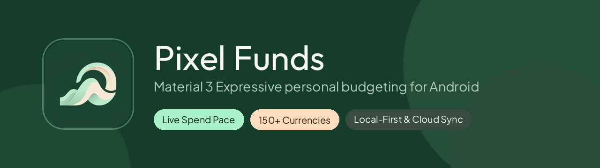

<div align="center">



<br />
<br />

[](https://github.com/VinujaHerath/Pixel-Funds/releases/latest)
[](https://github.com/VinujaHerath/Pixel-Funds/releases/latest)
[](https://github.com/VinujaHerath/Pixel-Funds/actions/workflows/android-ci.yml)

-3DDC84?style=flat-square&logo=android&logoColor=white)


<p>
  <strong>A personal budgeting app crafted for Pixel & Android users with Material 3 Expressive motion, live spend pacing, recurring bills & subscriptions, multi-period insights, and offline-first speed.</strong>
</p>

<p>
  <a href="#-download--install">Download APK</a> •
  <a href="#-features">Features</a> •
  <a href="#%EF%B8%8F-tech-stack">Tech Stack</a> •
  <a href="#-project-structure">Project Structure</a> •
  <a href="#-building-from-source">Build Locally</a> •
  <a href="docs/RELEASING.md">Releases</a>
</p>

</div>

---

## 📲 Download & Install

Grab the latest installable Android package directly from **GitHub Releases**:

> ### 👉 [**Download Latest APK from Releases**](https://github.com/VinujaHerath/Pixel-Funds/releases/latest)

**Install in 3 quick steps (Android 7.0+ / API 24+):**
1. Open the [**Latest Release**](https://github.com/VinujaHerath/Pixel-Funds/releases/latest) page and download the `.apk` file under **Assets**.
2. Tap the downloaded APK in your browser or the **Files** app (allow *Install unknown apps* if prompted).
3. Launch **Pixel Funds** — it works right away in private on-device mode, with optional Google Sign-In cloud sync in **Settings**.

> [!TIP]
> Every release also includes a `.sha256` file so you can verify APK integrity before installing, and every commit to `main` produces a preview build artifact under [**Actions → Android CI**](https://github.com/VinujaHerath/Pixel-Funds/actions/workflows/android-ci.yml).

---

## ✨ Features

| Area | What You Get |
| :--- | :--- |
| **🏠 Expressive Dashboard** | Hero remaining-budget squircle, live **Spend Pace** card with animated wavy progress indicator, **Safe / day** allowance (with optional upcoming bills reservation), and expandable **Top Categories** bento tiles. |
| **🔁 Recurring Bills & Subscriptions** | Track recurring bills and subscriptions across **weekly, biweekly, monthly, or yearly** cycles with due-date countdowns, active/paused toggles, and one-tap **Log paid**. |
| **🎯 Flexible Budgets** | Tune monthly category limits with tactile sliders, set custom warning thresholds (`55%–95%`), create custom categories with 17 curated icons & 10 accent swatches, and pick any reset day (**1st–31st**). |
| **⚡ Fast Expense Entry** | Custom numeric keypad bottom sheet with **One-time / Recurring / Subscription** entry modes, quick **Today / Yesterday** pills, and full calendar picker. |
| **📊 4-Mode Interactive Insights** | Switch between **Trends** (7D / 14D / 30D scrubbable daily bar chart), **Monthly** (6M/12M history, side-by-side month comparison & cumulative pace), **Yearly** (YoY category comparison), and **Mix** (fixed vs. flexible split, weekday pattern & top expenses). |
| **🧾 Activity, Search & Export** | Day-grouped transaction log with real-time merchant/category search, category filter chips, swipe-to-delete with **Undo** snackbar, and **CSV spreadsheet export**. |
| **📱 Built for Pixel Feel** | High refresh rate Smooth Display support, Android Predictive Back (`enableOnBackInvokedCallback`), **Material You** wallpaper colors, **Light / Dark / Device** themes, **150+ world currencies**, compact card density, haptics, and reduce-motion accessibility. |
| **🔒 Local-First + Cloud Sync** | Instant offline persistence via **Room**, plus optional **Google Sign-In** (Credential Manager + Firebase Auth) to sync and migrate categories, transactions, and recurring schedules to **Cloud Firestore**. |

---

## 🛠️ Tech Stack

- **Language & UI:** Kotlin `2.4.21`, Jetpack Compose, Material 3 Expressive (`Outfit` + `Plus Jakarta Sans` typography, custom spring motion tokens, high refresh rate & predictive back)
- **Local Storage:** AndroidX Room `2.7.0` (`PixelFundsLocalDatabase`) & Jetpack DataStore Preferences `1.1.7`
- **Cloud & Auth (Optional):** Firebase Auth, Cloud Firestore (owner-isolated security rules), Android Credential Manager (`googleid`)
- **Build & Tooling:** Gradle `9.3.1`, Android Gradle Plugin `9.1.1`, KSP, Secrets Gradle Plugin
- **Testing:** JUnit 4, Robolectric `4.16.1`, Compose UI Test, Firestore Rules Unit Tests (`firestore.test.js`)

---

## 📂 Project Structure

```text
Pixel-Funds/
├── .github/
│   ├── workflows/
│   │   ├── android-ci.yml         # Unit tests + debug APK artifact on every push/PR
│   │   └── release-apk.yml        # Automated APK + SHA-256 publishing to GitHub Releases
│   ├── ISSUE_TEMPLATE/            # Structured bug report & feature request forms
│   └── PULL_REQUEST_TEMPLATE.md
├── app/
│   └── src/
│       ├── main/
│       │   ├── java/com/example/
│       │   │   ├── MainActivity.kt              # Edge-to-edge, smooth display, theme, & auth router
│       │   │   ├── data/
│       │   │   │   ├── AppPreferences.kt        # DataStore prefs & ISO 4217 currency catalog
│       │   │   │   ├── BudgetRepository.kt      # Repository abstraction & starter seed data
│       │   │   │   ├── CadenceModels.kt         # Domain models, RecurringItem & LocalDay math
│       │   │   │   ├── CadenceRepository.kt     # Cloud Firestore sync & local migration
│       │   │   │   └── local/                   # Room entities, DAO, & LocalBudgetRepository
│       │   │   └── ui/
│       │   │       ├── CadenceApp.kt            # Navigation shell, settings overlay & transitions
│       │   │       ├── CadenceViewModel.kt      # Reactive UI state, CSV export & events
│       │   │       ├── auth/                    # Credential Manager Google Sign-In flow
│       │   │       ├── components/              # WavyProgressIndicator, FloatingPillToolbar, Haptics
│       │   │       ├── screens/                 # Dashboard, Budgets, Activity, Recurring, Insights, Settings
│       │   │       └── theme/                   # Color palettes, ExpressiveMotion, Typography
│       │   └── res/                             # Fonts, Material icons, strings, Firebase config
│       └── test/                                # JVM & Robolectric unit tests
├── docs/
│   ├── assets/                    # README banner & app icon assets
│   ├── ARCHITECTURE.md            # Deep dive into layers, storage, and theming
│   └── RELEASING.md               # Guide to cutting releases & configuring signing secrets
├── firebase-blueprint.json        # Firestore data model schema
├── firestore.rules                # Zero-trust owner-isolated Firestore rules
├── firestore.test.js              # Firestore security rules test suite
├── CHANGELOG.md                   # Version history
├── build.gradle.kts               # Root Gradle configuration
└── settings.gradle.kts            # Gradle module & toolchain setup
```

---

## 🧑‍💻 Building from Source

### Prerequisites
- **JDK 21** (Temurin or equivalent)
- **Android Studio** (or Android SDK with `compileSdk 36`)
- **Gradle 9.3.1** (if using CLI without Android Studio's Gradle sync)

### Run Locally
1. Clone the repository:
   ```bash
   git clone https://github.com/VinujaHerath/Pixel-Funds.git
   cd Pixel-Funds
   ```
2. *(Optional)* Copy `.env.example` to `.env` if you add API keys in the future.
3. *(Optional)* To enable **Google Sign-In & Cloud Firestore Sync** in your own build, place your Firebase `google-services.json` in `app/google-services.json`. Without it, the app builds cleanly and runs in full **on-device local mode**.
4. Generate a local `debug.keystore` (if you don't already have one in the repo root):
   ```bash
   keytool -genkeypair -v -keystore debug.keystore -storepass android \
     -alias androiddebugkey -keypass android -keyalg RSA -keysize 2048 \
     -validity 10000 -dname "CN=Android Debug,O=Android,C=US"
   ```
5. Build & run unit tests:
   ```bash
   gradle testDebugUnitTest assembleDebug
   ```
   The compiled APK will be at `app/build/outputs/apk/debug/`.

---

## 🚀 Releases & Contributing

- **Cutting a Release:** See [docs/RELEASING.md](docs/RELEASING.md) for tag-based automated APK releases and keystore secret setup.
- **Architecture Notes:** See [docs/ARCHITECTURE.md](docs/ARCHITECTURE.md) for data flow, Room/Firestore sync, and theme tokens.
- **Changelog:** See [CHANGELOG.md](CHANGELOG.md) for release history.
- **Issues & PRs:** Bug reports and feature ideas are welcome via the [Issue Tracker](https://github.com/VinujaHerath/Pixel-Funds/issues).
